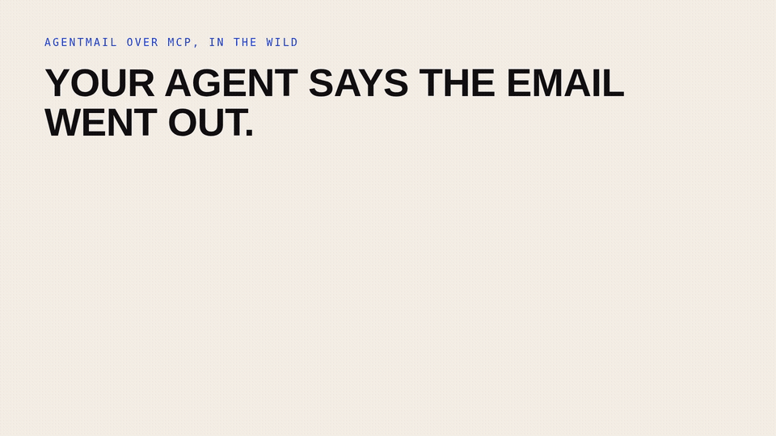

# Postmaster

**Your agent says the email went out. Postmaster checks what the server actually did.**

[](docs/demo.mp4)

*15 second demo: [docs/demo.mp4](docs/demo.mp4)*

One idea: when an agent uses email over MCP, the failure is usually silent. A model drops the subject and body and the send still "succeeds". A sign-in token expires and every call 401s until a human re-authenticates. A brand-new inbox 404s for a second and the agent concludes it does not exist. Postmaster is a conformance suite for AgentMail's MCP server: it runs real agent tasks, injects those failure modes, and checks every run against what actually happened on the server, not what the agent claims. One command: `python3 -m conformance run`.

## What this is (and what it is not)

Postmaster is a cross-model MCP conformance suite with an agent-readable error contract. It answers one question: when an agent uses AgentMail over MCP, did the thing it meant to do actually happen, and when it did not, could the agent tell why?

It is not a client library or a wrapper. AgentMail's MCP server and SDKs already send and receive mail. Postmaster checks the whole loop the way an agent experiences it: was the schema accepted, what happened on the server, and does the agent's own story match, with every failure tied to the exact tool call ID.

## The problem

These failure modes are not hypothetical. Each one comes from a public issue, and each was found by a user, one model at a time:

- Gemini's function calling rejected the send, reply and forward tool schemas. [agentmail-mcp#8](https://github.com/agentmail-to/agentmail-mcp/issues/8)
- Grok dropped optional subject and body args, delivering blank emails "with no way for the agent to know the content was lost." [agentmail-mcp#18](https://github.com/agentmail-to/agentmail-mcp/issues/18)
- Claude Code rejected tool results with "Invalid input: expected record, received string." [agentmail-mcp#5](https://github.com/agentmail-to/agentmail-mcp/issues/5)
- On the hosted server the sign-in token never refreshes; tools return 401 until a full manual re-authentication. [agentmail-mcp#50](https://github.com/agentmail-to/agentmail-mcp/issues/50)
- Sending right after `create_inbox` returns 404 "Inbox not found" for about 1 to 2 seconds. An agent reading that 404 concludes the inbox does not exist. [agentmail-node#14](https://github.com/agentmail-to/agentmail-node/issues/14)
- A reply labelled `unauthenticated` is invisible to list and search over MCP: "Legitimate inbound mail is unreachable through the MCP server." [agentmail-mcp#38](https://github.com/agentmail-to/agentmail-mcp/issues/38)

A conformance suite catches the next one before a user files the issue.

## What Postmaster does

Postmaster runs 7 scenarios through 4 agent tasks (onboard and send, reply with attachment, find an unauthenticated inbound message, survive a token refresh) against a local mock of the AgentMail MCP server: 154 checks per run.

- **Healthy runs pass.** The checks don't flag a correct server.
- **Each injected fault breaks only the tasks it should**, and every failed check is classified into a named error kind with the trace behind it.
- **The error contract turns a dead end into a retry.** The same fresh-inbox 404 fails without the contract and passes with it:

```json
{"status": 404, "message": "Inbox not found",
 "cause": "inbox_not_ready", "next_action": "/llms.txt#inbox-not-ready", "retry_after": 1.5}
```

Without the contract the agent reads `404 Inbox not found`, concludes the inbox does not exist, and gives up. With `cause` and `retry_after`, it waits 1.5 seconds and succeeds. The contract is the one server-side feature this takes: every error an agent can hit returns a machine-readable `cause`, a `retry_after` where it applies, and a `next_action` link into the docs. The suite asserts the contract on every run, so it cannot drift.

```
$ python3 -m conformance run
scenario                           onboard_and_send            reply_with_attachment       find_unauthenticated_inbound  survive_token_refresh
---------------------------------  --------------------------  --------------------------  ----------------------------  --------------------------------
healthy                            PASS                        PASS                        PASS                          PASS
schema_rejection                   FAIL schema_rejected        FAIL schema_rejected        PASS                          FAIL schema_rejected
drop_optional_args                 FAIL optional_args_dropped  FAIL optional_args_dropped  FAIL optional_args_dropped    FAIL optional_args_dropped
token_no_recovery                  PASS                        PASS                        PASS                          FAIL token_expired_unrecoverable
inbox_not_ready_404                FAIL inbox_not_ready        PASS                        PASS                          PASS
inbox_not_ready_404_with_contract  PASS                        PASS                        PASS                          PASS
hide_unauthenticated               PASS                        PASS                        FAIL unauthenticated_hidden   PASS

124/154 checks passed across 7 scenario(s).
```

In `reports/conformance.md`, every check row links to the exact JSON-RPC request and response for that tool call, including what the client did to the args (for example `dropped optional args: ['subject', 'text']`).

## Quickstart

You need Python 3 (tested on 3.13). There are no runtime dependencies, no API keys, and no network traffic; the server is in-process.

```bash
git clone https://github.com/karank2512/postmaster.git
cd postmaster
python3 -m conformance run
```

Other options:

```bash
python3 -m conformance run --scenario healthy --scenario drop_optional_args
python3 -m conformance run --faults drop_optional_args,hide_unauthenticated --no-contract
python3 -m conformance run --fail-on-error   # exit 1 if any check fails, for CI
```

## Failure modes reproduced

Every failure is reproduced for real by the mock server or the simulated client. Nothing is faked in the checks.

| Flag | Source issue | How the mock reproduces it | Detected as |
|---|---|---|---|
| `schema_rejection` | [agentmail-mcp#8](https://github.com/agentmail-to/agentmail-mcp/issues/8) | `send_message.to` and `reply_to_message.cc` use `anyOf`; the strict client rejects those tool declarations | `schema_rejected` |
| `drop_optional_args` | [agentmail-mcp#18](https://github.com/agentmail-to/agentmail-mcp/issues/18) | the client sends only required args; the server accepts the blank email and returns success | `optional_args_dropped`, plus `claim_mismatch` because the agent believes it worked |
| `token_no_recovery` | [agentmail-mcp#50](https://github.com/agentmail-to/agentmail-mcp/issues/50) | `auth/refresh` returns 401, so every call after expiry fails | `token_expired_unrecoverable` |
| `inbox_not_ready_404` | [agentmail-node#14](https://github.com/agentmail-to/agentmail-node/issues/14) | `404 Inbox not found` for 1.5s after `create_inbox` | `inbox_not_ready` (the store has the inbox, created under 5s before the 404) |
| `hide_unauthenticated` | [agentmail-mcp#38](https://github.com/agentmail-to/agentmail-mcp/issues/38) | `include_unauthenticated` is missing from the MCP schemas, and list/search filter out unauthenticated mail | `unauthenticated_hidden`, plus `claim_mismatch` |

`error_contract` is not a fault. It is the proposed fix: when it is on, every server error carries `cause`, `next_action`, and `retry_after` where it applies. The `errors_follow_contract` check flags every server error the agent had to act on that lacks those fields.

## Tasks and checks

Every task gets the same three checks: `schema_accepted`, `agent_claim_matches_truth`, and `errors_follow_contract`. The task-specific checks read only the store:

| Task | Truth checks |
|---|---|
| `onboard_and_send` | `delivered_exactly_once` from the new inbox; `content_intact` (subject and text match what the agent sent) |
| `reply_with_attachment` | `reply_delivered_exactly_once` (threaded via `in_reply_to`); `content_intact`; `attachment_intact` (filename + sha256 + size) |
| `find_unauthenticated_inbound` | `inbound_visible_via_mcp`; `agent_found_message` |
| `survive_token_refresh` | `session_recovered`; `delivered_exactly_once`; `content_intact` |

## How the mock works

`mock_agentmail/store.py` is the server-side truth: inboxes, messages, and attachments with sha256. `mock_agentmail/server.py` speaks JSON-RPC (`auth/login`, `auth/refresh`, `tools/list`, `tools/call`). `mock_agentmail/client.py` is a simulated model client with the observed quirks: strict-schema validation, optional-arg dropping, 401 refresh handling, and per-call trace IDs. `mock_agentmail/clock.py` is a fake clock, so "wait 1.5s" and "idle overnight" cost nothing.

## Project layout

| Path | What it is |
|---|---|
| `conformance/tasks.py` | the 4 tasks: scripted agent behavior + truth checks for each |
| `conformance/checks.py` | shared checks and trace-based classification into error kinds |
| `conformance/contract.py` | `ERROR_KINDS`: the agent-readable error contract (retryable, next_action, issue) |
| `conformance/agent.py` | `ContractAwareAgent`: retries only when an error carries `retry_after` |
| `conformance/scenarios.py` | the 7 built-in scenarios |
| `conformance/harness.py` | runs a scenario on a fresh mock and collects checks + traces |
| `conformance/report.py` | JSON + Markdown rendering |
| `mock_agentmail/` | the local mock: store, server, simulated client, faults, clock |
| `tests/` | pytest: mock fault reproduction and harness detection |

## Running the tests

```bash
python3 -m pip install pytest
python3 -m pytest -q    # 29 passed
```

## Limits

- **This is a prototype.** It shows the approach working end to end. It is not a hardened tool.
- **The server is a mock.** Everything runs against a local stand-in for the AgentMail MCP server, built from the open-source agentmail-mcp repo and public issues. There is no AgentMail account, no API key, and no network traffic.
- **The agent is scripted, not an LLM.** It plays a careful agent: it trusts tool results and retries only when told how long to wait. The model quirks are flags on the simulated client. Next step: real model clients behind the same `call(tool, args)` interface, turning scenarios into model x harness rows.
- **Not affiliated with AgentMail.** The `mock_agentmail` package name only describes the API being modeled. This project is not made, reviewed, or endorsed by AgentMail.
